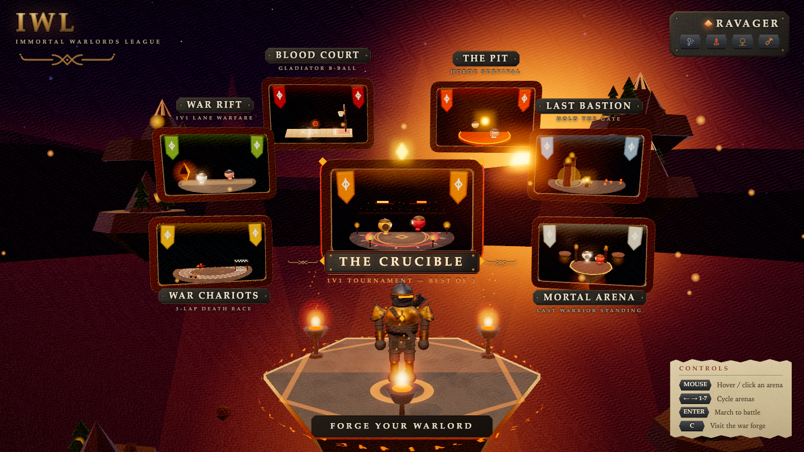
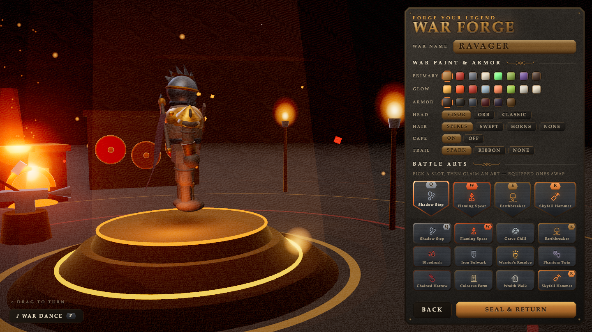
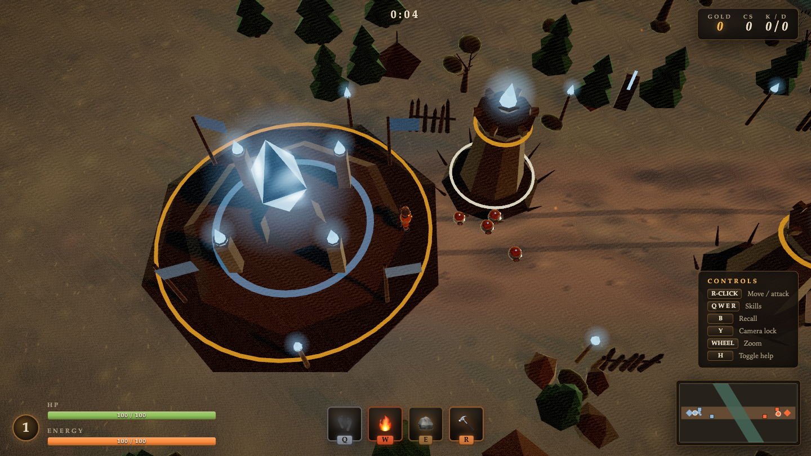
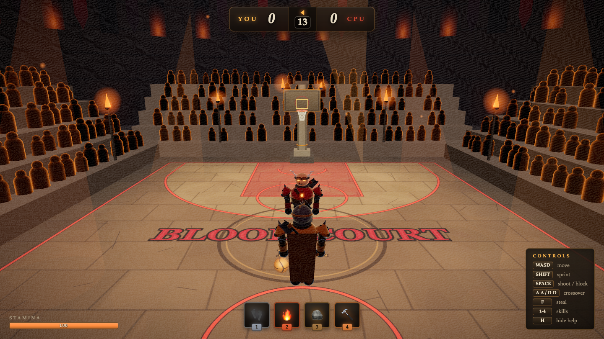
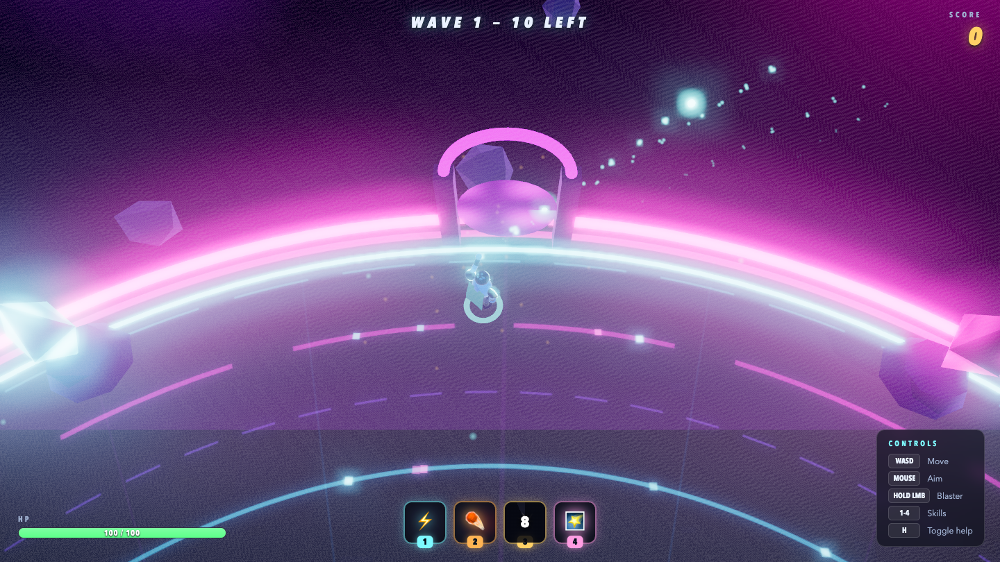
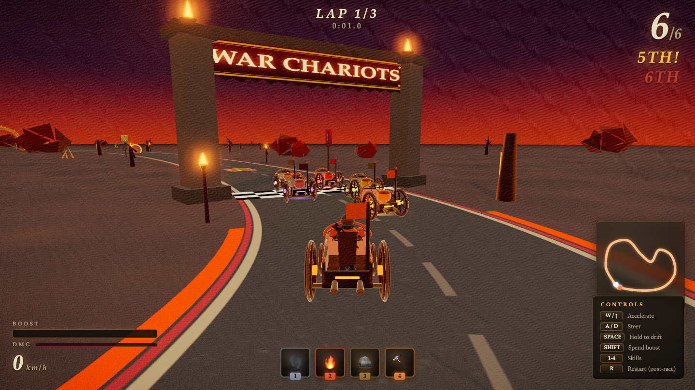
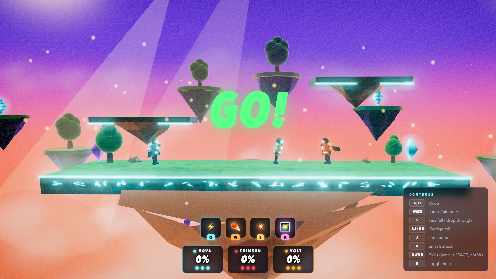
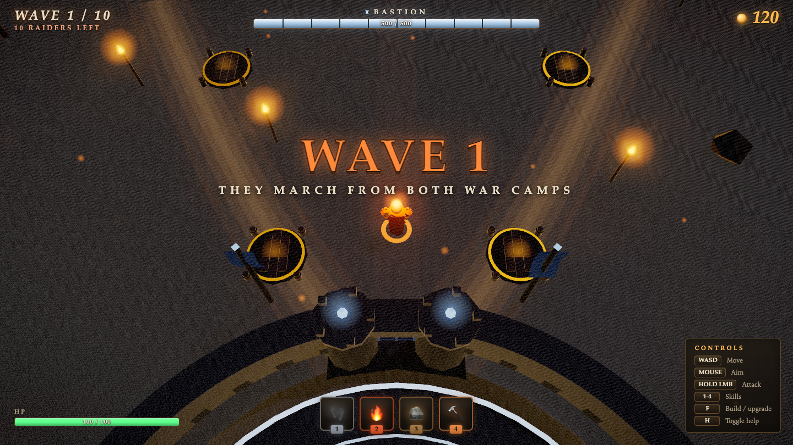

# Warrior League

Forge one warlord and carry the same appearance and four battle arts into seven playable dark-fantasy battlegrounds. The cinematic Convergence hub frames your warrior against an eclipsed sun, weathered ruins, and a distant mountain citadel.

The Astra immersion branch adds direct battle entry with your saved loadout, an accessible realm selector and forge, arrow movement in every battleground, a consistent field HUD, cached scene loading with recovery, and shared pause/settings. Pausing freezes gameplay, countdowns, delayed events, and visual effects together. Switching away from a match pauses it until you return.

Mortal Arena and The Crucible's **Single Duel** offer saved **CPU levels 1 through 10**, starting at level 6. Set a level in the hub or pause menu; changes during a match apply on restart or the next match. Higher levels improve reactions, defense, attack choices and recovery while keeping fighter stats unchanged. The Crucible's original **Tower** retains its four-opponent difficulty progression. [CPU tuning and verification](docs/cpu-difficulty.md) explains the scale.

The game combines textured character meshes with procedural environments, effects and audio. All assets used during play are local. Rendering uses physically based materials, dynamic shadows, restrained bloom, subtle grain and adaptive resolution. The compact realm thumbnails are captures of the actual games.

The forge includes **Caelan, Nyra, Orren and Serai**, with three selectable skins each and signature defaults. Caelan and Nyra now have complete textured, animated bodies reconstructed from their production artwork, with distinct proportions, coherent faces, integrated clothing and signature equipment. Their current rendering is the user's [approved standard for character and game art](docs/art-standard.md). Orren and Serai retain their earlier bodies while new mesh generation awaits provider quota. The two upgraded bodies use curated skin colorways and weapon variations. Names, battle effects and battle arts remain customizable. See [current character production and provenance](docs/character-art-rebuild.md) and [character UI](docs/champion-ui.md).

The [character art collection](public/concepts/index.html) preserves all twelve illustrations and four comparison boards. With the development server running, open `http://localhost:5173/concepts/index.html` to browse and zoom into the originals. The artwork guides the playable costumes. [Art direction and prompts](docs/concepts/champions/README.md) are preserved in the repository.


## The battlegrounds

| Arena | Clone of | What your battle arts become |
|---|---|---|
| **War Rift** | League of Legends | Shadow Steps, Flaming Spears, Skyfall Hammers — lane warfare vs an AI champion with raiders, watchtowers, gold & levels |
| **Blood Court** | NBA 2K / NBA Jam | Gladiator ball in a torchlit colosseum — colossus dunks and comet alley-oops, first to 11 |
| **The Pit** | Horde brawler | Full power fantasy vs 8 waves and the Pit Warden in a volcanic fighting pit |
| **War Chariots** | Mario Kart | Flaming ballista bolts, ice slicks, colossus mode — a 3-lap death race through scorched badlands |
| **Mortal Arena** | Super Smash Bros | Damage-% knockback over a lava chasm, 3 stocks, blood-red moon — last warrior standing |
| **Last Bastion** | Tower defense | Build ballista towers and hold the gate through 10 waves and the Siege Colossus |
| **The Crucible** ⚔ | Mortal Kombat | The flagship: best-of-3 duels, chains that cancel into your arts, juggles, a 4-fight tower, and the OBLITERATE finisher |

The same 12 battle arts (Shadow Step, Flaming Spear, Grave Chill, Earthbreaker, Bloodrush, Iron Bulwark, Warrior's Resolve, Phantom Twin, Chained Harrow, Colossus Form, Wraith Walk, Skyfall Hammer) are reinterpreted per battleground — the War Forge tooltips tell you what each art does in each world before you enter.

## Earlier battleground screenshots

| | |
|---|---|
|  |  |
|  |  |
|  |  |
|  |  |


## Run it

```bash
npm install
npm run dev        # → http://localhost:5173
```

Jump straight into a scene: `http://localhost:5173/?scene=duel|moba|hoops|arena|kart|brawl|siege|hub|loadout` (`&mute=1` for silence).

## Controls

- **Hub**: click a realm to select it, then Enter Battle. Arrow keys or 1-7 select realms, Enter plays, C opens the forge, and H shows the selected controls.
- **War Rift**: arrows move, right-click move/attack, QWER arts, B recall, Y camera lock, wheel zoom. Arrow movement replaces mouse orders and cancels recall. Enter the allied fountain platform for an immediate full-health restore.
- **Blood Court**: right-click a destination or use WASD/arrows to move, Shift sprint, hold/release Space to shoot, F steal, double-tap A/D or left/right crossover, 1-4 arts.
- **The Pit**: right-click a destination or use WASD/arrows to move, aim with mouse, hold LMB blaster, 1-4 arts.
- **War Chariots**: W/up accelerates, S/down brakes, A/D or left/right steers, hold Space to drift, Shift spends boost, 1-4 arts.
- **Mortal Arena**: A/D or left/right moves, Space/up jumps, S/down fast-falls, J jab, K smash, double-tap left/right or A/D dodges, QWER arts.
- **Last Bastion**: right-click a destination or use WASD/arrows to move, aim with mouse, hold LMB blaster, F build/upgrade ballistae, 1-4 arts.
- **The Crucible**: right-click a destination to walk; A/D or left/right walks (double-tap to dash), Space/up jumps, S/down crouches, Shift blocks, J/K light/heavy, F throws, QWER arts.
- **P / Esc**: pause a game or resume from its menu. Use the menu to restart or return to the hub. Escape leaves the forge. H toggles help in games.
- **Settings**: mouse sensitivity (0.25× to 2×, with Reset), sound, Auto / High / Performance quality, and reduced motion are saved on this device. Gameplay requires a keyboard and mouse; hub and forge layouts also adapt to narrow screens.

Mouse sensitivity changes mouse-driven camera movement, War Rift edge scrolling, and Forge rotation. Cursor aiming and click destinations stay aligned with the visible pointer. Keyboard movement and pausing cancel new click-to-move orders; Last Bastion routes around the citadel. Blood Court shots retain their existing basket targeting. The Crucible also supports right-click walking, with keyboard/combat input cancelling the order. Mortal Arena and racing retain their directional controls.

## Share a play link

Build and serve only the production assets, then open a temporary Cloudflare tunnel:

```bash
npm run build
python3 tools/serve-game.py --port 5189
# In another terminal, with cloudflared installed:
cloudflared tunnel --url http://127.0.0.1:5189
```

Share the printed HTTPS URL. No account or installation is needed on the receiving laptop. Anyone with the link can play their own local single-player session; this does not add multiplayer. Keep the host Mac awake, online, and both processes running. Stop the tunnel to disable sharing. A new tunnel gets a new URL.

## Architecture

- `src/core/` — engine (renderer, post chain, loop), input hub, scene router, procedural audio
- `src/art/`: physically based materials, textured champions, environment kit, character factory and VFX pool
- `src/meta/` — hub, War Forge, the universal 12-art catalog
- `src/games/` — one folder per battleground, each a self-contained scene module
- `qa/` — Playwright screenshot + real-input probes used to verify every flow

`CONTRACTS.md` documents the scene-module contract, shared API, and the warrior art direction. The current QA coverage and limitations are recorded in [docs/astra-immersion.md](docs/astra-immersion.md).

## Verify the immersion pass

```bash
npm run build
npm run preview -- --host 127.0.0.1 --port 5299 --strictPort
node qa/probe-immersive.mjs
node qa/probe-immersive-recovery.mjs
node qa/probe-immersive-final.mjs
node qa/probe-field-controls.mjs
node qa/probe-field-results.mjs
node qa/probe-field-tooltips.mjs
node qa/inspect-champions.mjs
node qa/probe-art-gallery.mjs
IPL_BASE=http://127.0.0.1:5299 node qa/probe-champion-ui.mjs
IPL_BASE=http://127.0.0.1:5299 node qa/capture-champion-portraits.mjs
# Model studio probes import source modules, so use the Vite development server:
IPL_BASE=http://127.0.0.1:5173 node qa/capture-roster-models.mjs
IPL_BASE=http://127.0.0.1:5173 node qa/probe-roster-models.mjs
IPL_BASE=http://127.0.0.1:5173 node qa/probe-anatomy-lifecycle.mjs
IPL_BASE=http://127.0.0.1:5173 node qa/capture-anatomy-details.mjs
IPL_BASE=http://127.0.0.1:5173 node qa/capture-roster-lineup.mjs
```

These probes use isolated headless Chrome profiles and exercise real controls. Artifacts go to `qa/screens/immersive/`, `qa/screens/field/`, `qa/screens/champions/`, `qa/screens/gallery/`, `qa/screens/models/`, `qa/screens/model-qa/`, and `qa/screens/anatomy-lifecycle/`. Set `IPL_BASE` to use another running preview. `qa/capture-realm-previews.mjs` regenerates the local realm artwork from the development server on port 5199.
