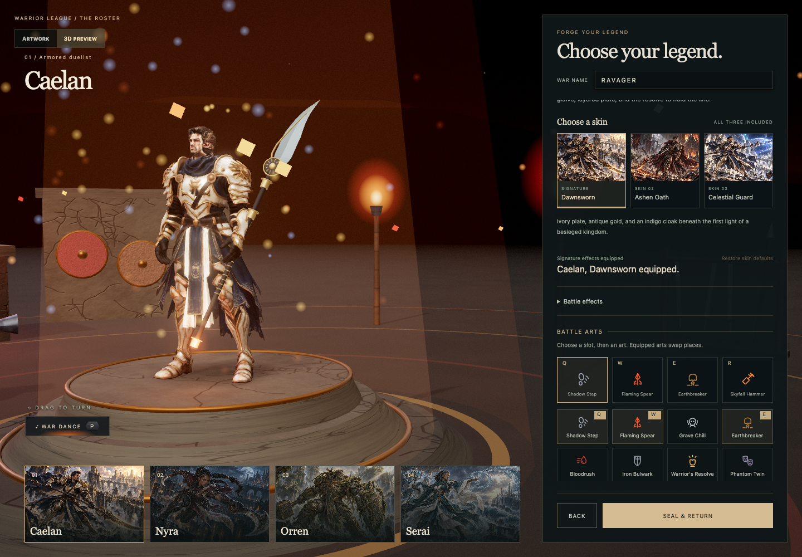
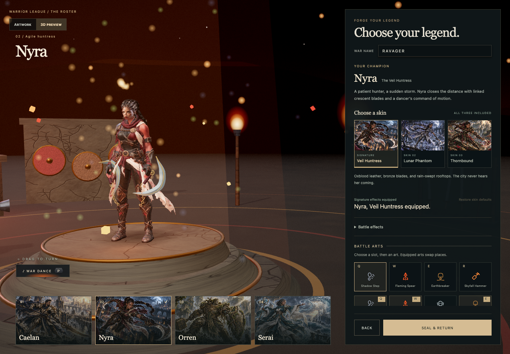

# Approved character and game art standard

Vivek approved the current Caelan and Nyra rendering on September 18, 2026: "really nice rendering tbh, lets keep this as the standard for character art and game art in general".

Their version 4 textured, animated bodies establish the visual quality reference for Warrior League and future game art. Preserve this quality while developing each character, creature, weapon, prop and environment in its own design language. The principles below describe the approved result; they do not require every future game to share Warrior League's palette or fantasy setting.

## Visual references

| Approved reference | What to compare |
|---|---|
| [Caelan in the Forge](screenshots/unified-caelan-forge.png) | Sculpted armored silhouette, mature face, integrated costume, detailed surfaces and grounded lighting |
| [Nyra in the Forge](screenshots/unified-nyra-forge.png) | Distinct lean proportions, coherent face and braids, asymmetric leather costume and individual equipment |
| [Caelan in gameplay](screenshots/unified-caelan-duel.png) | Character readability, material response and identity under actual game lighting |

The approved characters in these images are the references. Older opponents or background assets appearing beside them are still subject to improvement.

## Qualities to preserve

- Give each character its own anatomy, proportions, silhouette, posture and equipment. Individuality should remain apparent before color and skin variants are applied.
- Build a coherent full character. Face, hair, body, costume and hands should share a consistent level of detail and a believable relationship to one another.
- Give surfaces convincing material properties. Skin, cloth, leather, stone and metal should respond differently to light, with modeled volume, restrained highlights and intentional wear.
- Make fantasy feel tangible through weight, contact shadows, fitted equipment, cloth movement and lighting that places each subject in its environment.
- Apply the same care to creatures, weapons, architecture, props and terrain: distinctive forms, coherent materials, purposeful detail and clear focal points.
- Preserve identity and readability at gameplay distance as well as in the Forge. Check faces, fingers, equipment and silhouettes from the front, side and back, including animation and combat poses.
- Keep optimization visually accountable. Compare actual renders before and after changes to meshes, textures, materials or lighting. Preserve the approved appearance and verify relevant gameplay and resource-lifecycle behavior.

## Baseline and ongoing work

The baseline uses [Caelan's mesh](../public/models/champions/caelan.glb) and [Nyra's mesh](../public/models/champions/nyra.glb), their production textures, the current character shaders and the eighteen-anchor runtime rig. [Packing validation](champion-packing-validation.json) records their hashes and verifies identical rendering after the lossless size reduction. [The production record](character-art-rebuild.md) links source artwork, prompts, preparation tools and gameplay checks.

Orren and Serai still need replacement bodies that meet this reference. Their older models do not establish the standard. Higher-detail Caelan and Nyra candidates are refinements of an accepted baseline and must improve the result before replacing it. Existing close-up limitations remain useful refinement targets; they do not invalidate the user's approval.

The standard governs future art changes and review. It does not imply that every existing asset has already been brought to this level. Keep the approved runtime assets until replacements have been inspected in the Forge and in affected games.

**Executive summary:** The current Caelan and Nyra rendering is the approved visual benchmark. Preserve its coherent anatomy, individual silhouettes, detailed materials and immersive lighting throughout future character and game art.
