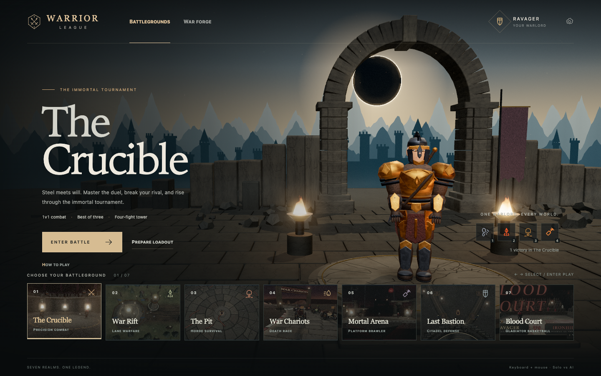
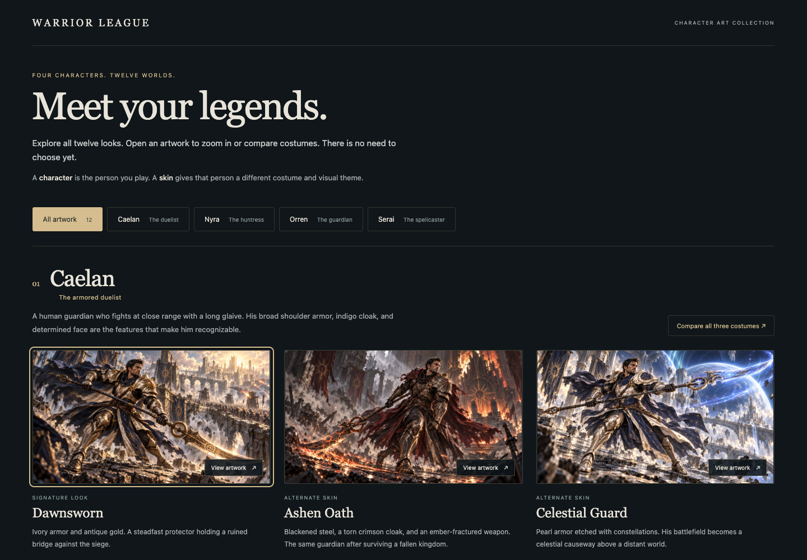

# Astra immersion pass

Implemented on `feat/astra-immersive-realms`, based on `feat/otherworldly-pass` at `1a81f4c`. Astra agents contributed the procedural world, shared runtime, and independent adversarial reviews. Changes are local and have not been deployed.

The Convergence now offers direct entry into all seven games with the saved warrior and four arts. A new eclipse courtyard, weathered stone arch, distant citadel, fire, mist, and revised hero silhouette surround a responsive realm selector. The forge has clearer controls and inline art descriptions. Shared settings, deliberate loading states, recovery actions, input reset, and simulation-time timers make transitions and pause behavior consistent across games.

The follow-up adds arrow movement in every mode, a shared restrained field HUD, collapsible Controls, readable art names and tooltips, responsive result cards, and rebuilt procedural champions and retainers. Champions have connected sculpted anatomy, articulated hands, fitted armor, facial details, and four silhouette families. The character rig API remains compatible with all seven games. The [character art collection](concepts/champions/README.md) provides original splash illustrations and skin studies. All four champions and twelve skins were subsequently accepted and [integrated into the character UI](champion-ui.md).

## Verification

The production build and 445 follow-up browser assertions pass: 177 field-input/layout checks, 71 responsive result checks, 64 tooltip/cinematic checks, 58 recovery/result checks, 16 final startup/navigation checks, and 59 art-gallery checks. The original 68-check pass is retained as historical evidence for unchanged flows. Repeatable probes run against Vite's production preview in isolated Chrome profiles, with a separate live Chrome inspection of the game. See the commands in the repository README and the [saved assertion results](astra-qa-results.json). Full probe outputs and screenshots go to `qa/screens/`, which is intentionally ignored by Git. Passing results are reused when later changes do not affect their scope.

| Area | Exercised controls and states | Result |
|---|---|---|
| Startup | Real loading, disabled Begin button, keyboard focus containment, input blocking, first gesture audio, WebGL unavailable, Try again | Passed |
| Convergence | Seven realm cards, arrow keys, numeric keys, Enter Battle, Prepare loadout, Battlegrounds, War forge, four art shortcuts, How to play, H and C shortcuts, Settings | Passed |
| Forge | Name persistence, 22 swatches, 12 appearance options, four slots, all 12 arts, dance button and P shortcut, turntable drag and blur reset, Back, Seal & return, Enter battle, Escape | Passed |
| Settings | Sound, three quality modes, reduced motion, saved preferences, focus wrapping, Escape, responsive layout | Passed |
| Seven games | Four arrow directions, jump/crouch/fast-fall mappings, kart acceleration/brake/steer, mixed WASD/arrow releases, recall/order cancellation, four equipped arts, P and visible Pause, simulation freeze, Resume | Passed |
| Session lifecycle | Restart, blur pause, held input release, failed module import, Retry, unknown route recovery | Passed |
| Results | Win and loss in every game, paused result timers, correct win increments, all return/retry actions, contained result cards and readable narrow tables | Passed |
| Responsive UI | 1440 x 900, 900 x 800, 700 x 800, 390 x 844; help, ability slots, maps, scoreboards, pause controls, result layouts | Passed |
| Tooltips and cinematics | All four art tooltips in seven modes at desktop/narrow widths; hidden cinematic controls cannot intercept clicks | Passed |
| Characters | All 12 head/hair combinations, articulated champion in each game, geometry and animation review, kart driver pose, minion stride, material identity and appearance controls | Passed |
| Art gallery | Twelve splash illustrations, four comparison boards, five filters, image-viewer open/close/focus, previous/next/wrap, zoom/fit/pan, keyboard shortcuts, original PNG links, both return-to-game links, loading/error/retry, 1440/700/390px layouts | Passed |
| Rendering | Inspected hub, forge, settings, seven game views, narrow HUDs, result views, loading failure; controls clear the meters and maps | Passed |

Result-flow checks trigger each scene's existing debug win/loss hook, then exercise the production result UI and timers. They do not represent full naturally completed campaigns. The probes equip every art; they do not exhaustively replay every skill combination or rebalance existing combat mechanics.

Independent Astra reviews identified and verified fixes for background input during boot, focused realm-card Enter behavior, destination-specific forge key labels, narrow-screen art descriptions, hidden-tab pause ordering, resume focus, deferred audio startup, and scene resource cleanup. Focused Three.js disposal checks confirmed instance buffers, shadow targets, and all composer render targets are released. The bloom pass's remaining high-pass shader material is explicitly disposed as well.

Follow-up independent reviews checked aliases, held-key release ordering, pause resets, model geometry and animation contracts, and HUD interaction boundaries. Fixes include clearing stale double-tap histories on pause, grounding the kart driver's feet, keeping the gemstone backing fixed, closing the retainer's thigh/body gap, and making hidden cinematic ability bars inert. Visual QA also found and corrected the narrow brawler result table. Field movement probes measure elapsed simulation time to avoid treating a rendering stall as failed movement; skill checks allow for normal hitstun and recovery before testing cooldown display.

An independent gallery review identified keyboard conflicts. Browser modifier shortcuts now remain available, and arrow keys pan a zoomed image when its viewport has focus. These fixes passed the gallery browser probe. All twelve individual illustrations were visually inspected; the gallery preserves complete image compositions and provides the full-resolution originals.

## Follow-up queue and practical limits

- The in-game characters remain procedural and stylized. Approved champions and skins are selectable in the UI with matching rig presets and palettes. Matching the illustrations with authored geometry, textures, rigs, and animation remains a separate stage.
- Gameplay uses keyboard and mouse. Responsive hub and forge layouts do not provide touch gameplay or gamepad support.
- Performance was observed in local Chrome, including roughly 60 FPS in the hub at 1440 x 900 and DPR 1. A device matrix and longer memory/performance soak remain future work; this is not a universal frame-rate guarantee.
- Existing natural campaign balance and the complete cross-game skill matrix remain outside this UI and session pass.

**Executive summary:** Arrow movement, the field HUD, connected character models, and shared gameplay lifecycle are implemented and browser-verified. The approved four-champion, twelve-skin roster is now integrated into the UI; its follow-up verification is recorded separately.
