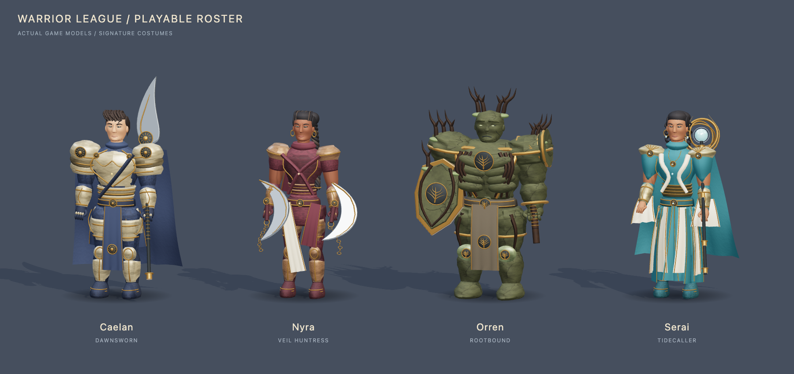

> Historical v2 implementation, rejected by the user for cartoonish faces and a common body silhouette. Functional test success did not establish visual acceptance. Superseded by [the v3 anatomical rebuild](champion-models.md).

# Playable champion models

Implemented locally on `feat/astra-immersive-realms`. The previous roster applied colors and silhouette presets to one generic armored body. The new models build the approved identities into actual articulated gameplay geometry.

| Champion | In-game identity | Alternate costume geometry |
|---|---|---|
| Caelan | Exposed face and swept hair, layered ivory plate, sun emblems, indigo cloak, long glaive | Ashen blade fissures and ragged crimson cloak; celestial crown, constellation accents and glaive halo |
| Nyra | Athletic fitted leather, crown braids and a moving long plait, scarves, twin crescent blades with chain links | Lunar veil and moon arc; thorn growth and petal shoulder layers |
| Orren | Broad cragged stone body, carved face, root growth, shield arm and bell hammer | Furnace vents and molten seams; glacial crystals and silver ornament |
| Serai | Coiled hair, jewelry, lamellar waist, layered robes and sleeves, armillary ring staff | Star diadem and expanded orrery; desert headwrap, hanging scarf and sand silk |

All four retain the shared combat anchors and gameplay proportions. Distinct resting poses and cadence, cloth movement, Nyra's swinging braid, and Serai's rotating staff core supplement the existing run, cast, dance and knockdown animation. Court, chariot and fist-fighting modes stow signature equipment on the back or hip; the remaining modes carry it in hand. Hero clones inherit the same identity and appropriate equipment pose. Collision shapes, attack reach, balance, and equipped arts are unchanged.

`appearance.championId` and `appearance.skinId` select the correct model in every game. Profile loading derives those values from validated roster selection, then preserves custom paint and gameplay progress. Generic head/hair recombination is retired from the forge so it cannot replace the approved identities; paint, cape and trail controls remain available. Legacy NPC appearances still use the existing model builder.

The production code is in `src/art/rosterModels.js`, `championGeometry.js`, and the shared `characterFactory.js`. Static costume details batch only within each animation joint. Materials remain independent per hero so clone tints and hit flashes cannot recolor the player. Orren's hit-flash alias addresses his actual stone body.

## Verification checklist

The production build and **247 browser assertions pass**, with zero browser errors. All 28 champion/game combinations were exercised. Full results are recorded in [champion-model-results.json](champion-model-results.json). Representative gameplay captures show [Orren in Blood Court](screenshots/rejected-v2/model-orren-hoops.png) and [Serai in Last Bastion](screenshots/rejected-v2/model-serai-siege.png).

Costumes contain 47,560 to 79,164 triangles and 62 to 100 meshes. Brief movement/casting samples at 1440 by 1000 and DPR 1 recorded median frame intervals of 16.5 to 16.7 ms, with per-run 95th percentiles of 17.2 to 20.8 ms. These are local smoke-test observations, not a sustained or cross-device performance guarantee.

The repeatable browser probe is `qa/probe-roster-models.mjs`. It uses an isolated headless Chrome profile and a Vite development server, without attaching to the user's browser. It covers:

- All twelve skins in idle, run, cast, dance and knockdown poses, including finite geometry, transforms and hand anchors.
- Held/stowed attachment round trips, independent clone materials, correct palette aliases, and Orren's body hit feedback.
- Repeated roster rebuilds and stable GPU geometry/texture counts.
- All 22 paint swatches, cape on/off, three trail states, palette reset, twelve skin choices, and each champion's dance start/stop through real controls.
- Each of four champions in each of seven games, with actual arrow-key movement, a casting action, equipment placement, browser errors, screenshots and frame samples.
- Forge previews at desktop, tablet and phone widths.

`qa/capture-roster-models.mjs` renders every costume in neutral studio light. `qa/roster-studio.html` is a development-only inspection page, outside the production build. Captures and detailed probe logs are under `qa/screens/models/` and `qa/screens/model-qa/`.

An independent Astra review checked geometry, animation anchors, batching, equipment reparenting and profile migration. It verified 86 profile assertions and identified two integration defects: a duel twin carrying its weapon while the fighter stowed it, and Orren's damage flash addressing only knee badges. Both were fixed and independently rechecked.

## Art production boundary

These are champion-specific procedural meshes with layered costumes, physically based materials and real three-dimensional equipment. They remain stylized. The illustration's fine anatomical sculpting, hand-painted or baked texture detail, cloth simulation and motion-captured animation are not reproduced by this implementation. No external model service or downloaded character assets are used.

Further art production can replace individual builders with textured, skinned assets while retaining the named combat anchors and stable champion/skin IDs. This is an art quality follow-up, not a hidden substitute for an implemented runtime feature.

**Executive summary:** All four approved character identities now have distinct playable models and twelve modeled costume variants. They preserve the shared gameplay contracts and bring the art's defining silhouettes and equipment into the games; final illustrated or AAA character fidelity remains beyond this procedural pass.
