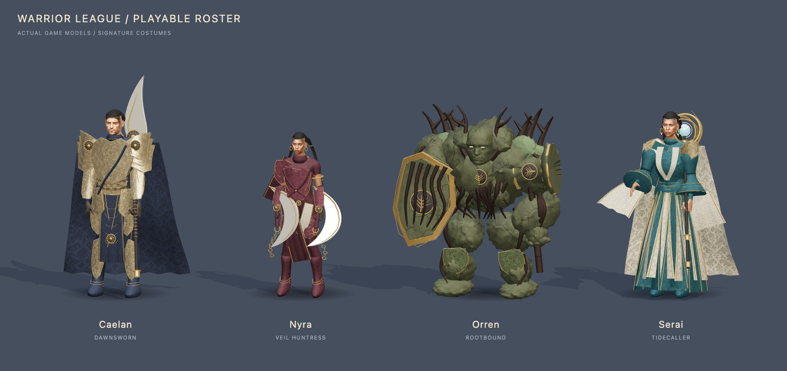

# Playable champion anatomy rebuild

Historical version 3 record. The user rejected this visual result. Caelan and Nyra now use the version 4 path in [character-art-rebuild.md](character-art-rebuild.md); Orren and Serai remain on this version while exports are blocked by provider quota. These older test results do not establish acceptance of the current visual target.

Implemented locally on `feat/astra-immersive-realms`. This version replaces the rejected cartoon faces and common body template with anatomical human meshes and a separate stone creature. The approved Warforge illustrations remain the design reference for each champion's identity, costume and signature equipment.

| Champion | Body and face | Costume, equipment and movement |
|---|---|---|
| Caelan | Tall, broad adult male; angular jaw, natural facial anatomy, stubble and weathering | Layered ceremonial plate, indigo cloak, sun glaive and an upright guarded stance |
| Nyra | Shorter, lean athletic female; different facial structure and skin texture | Asymmetric leather armor, crown braids and two moving plaits, chain crescents and a low hunting stance |
| Orren | Broad, hunched stone creature; short heavy legs, uneven shoulders, oversized shield arm and an embedded carved face | Fractured rock, roots, shield and bell hammer; separate furnace and glacier details for alternate skins |
| Serai | Tall, narrow adult female; mature facial features, silver-threaded curls and an open casting hand | Wide layered robes, bell sleeves, ivory lining and a ring staff; a flowing silhouette distinct from armor |

All twelve skin IDs, signature defaults, paint controls, equipment attachments and gameplay abilities remain supported. The selected model is used in War Rift, Ashfall Arena, Last Bastion, Blood Court, Iron Chariots, Godfall and Ascension. Legacy NPCs use the existing lighter models.

## Geometry and texture production

The human bodies are independently morphed versions of CC0 MakeHuman graphical data, with thirteen gameplay bones and smooth vertex weights. This gives the head, neck, shoulders, arms and hands a continuous anatomical surface. The faces use generated texture detail, fitted anatomical eye geometry and natural proportions. The clothing and equipment are custom meshes. Orren has a separately built rock-and-root body rather than a scaled human torso.

[Source assets and conversion instructions](../tools/character-assets/README.md) include the pinned upstream commit, copied asset license, morph parameters and deterministic Python conversion script. Only graphical data is used; no upstream application code is copied. The generated mesh data is in `src/art/anatomy/`. Runtime rendering is implemented in `src/art/anatomicalRig.js`, `rosterModels.js`, `championEquipment.js` and the shared `characterFactory.js`.

Three facial textures, an engraved metal surface, woven brocade and a hair atlas were generated with the built-in imagegen tool. The [face and surface prompt record](concepts/champions/model-texture-prompts.json) and [hair prompt record](concepts/champions/hair-texture-prompt.json) preserve the prompts and references. Original PNGs are in `tools/character-assets/texture-sources/`; runtime WebP files are in `public/models/textures/`. The fitted eyes and brown eye atlas are also CC0 source assets.

These are real articulated 3D models used during gameplay. The illustrations are not substituted for the playable geometry. Close views still reveal constructed costume surfaces, projected face textures and hair cards; the result does not reproduce every sculpted, painted or animated detail of the splash art.

## Runtime contracts

- Preserve `hips`, `torso`, `head`, `gem`, `arms.L/R.{pivot,elbow,glove}` and `legs.L/R.{pivot,knee}`. Each game layers its combat poses over these anchors.
- Resting pelvis height comes from `hero.hipHeight`, including kart seating and knockdown recovery. The human bodies have different heights and proportions, and Orren has its own lower pelvis.
- Each human has three or four single-material skinned mesh parts sharing one hero-owned skeleton. Rigid details batch within a joint; skinned meshes are never merged into those batches.
- Hero instances own their materials, face/eye/hair/surface GPU textures and skeletons. Only decoded image data is cached globally. Late image completions cannot repopulate disposed textures.
- `hero.assetsReady` resolves after textures are populated. Startup prepares every champion texture before allowing entry, and exposes a reload/retry action on failure.
- Court, kart and fist-fighting modes stow equipment. Other modes carry it in hand. Held/stowed transitions restore exact attachments, including Orren's shield.
- Primary and secondary material aliases retain the saved palette. Damage feedback addresses Orren's stone body. Ghost effects deduplicate shared materials before saving opacity, and clones preserve the custom face shader.
- Expired court and MOBA clones release their meshes, textures and skeleton resources. Their cleanup leaves the player's textures intact.

## Verification and coverage

The production build and 247 roster/browser assertions pass. All 16 lifecycle assertions pass in both development and production previews, with zero unexpected browser errors. The final records are [roster results](champion-model-results.json), [development lifecycle results](champion-anatomy-results.json), [production lifecycle results](champion-anatomy-production-results.json) and the [tested source fingerprint](champion-anatomy-validation.json). Probes use isolated headless Chrome profiles and do not attach to the user's browser.

| Surface or behavior | Checked states |
|---|---|
| All twelve models | Idle, run, cast, dance and knockdown; finite mesh data and transforms; bounded casting anchors |
| Champion and skin controls | All four champions, all twelve skin buttons, matching saved identity and visible 3D preview |
| Appearance controls | All 22 paint swatches, cape on/off, all three trails and palette reset |
| Animation and equipment | Dance start/stop for each champion, held/stowed round trips, independent clone tinting |
| Every game | All 28 champion/game combinations, actual arrow-key movement, a cast action, equipment placement and browser errors |
| Layout | Desktop, 900 px tablet and 390 px phone previews and selection controls |
| Asset loading | Entry disabled while a face texture is delayed; visible preparation status; failed texture request; retry succeeds |
| Live ability lifecycle | Wraith Walk applies and restores body opacity; real MOBA and court clones render, expire and release captured resources |
| Resource stability | Repeated roster rebuilds, private player/clone textures, disposal and stable GPU object counts |
| Visual inspection | All twelve costume renders; front, side and back head captures; actual forge and gameplay screenshots |

The main probe is `qa/probe-roster-models.mjs`; loading and clone recovery are checked by `qa/probe-anatomy-lifecycle.mjs`. `qa/capture-roster-models.mjs`, `qa/capture-anatomy-details.mjs` and `qa/capture-roster-lineup.mjs` produce the visual evidence. `qa/roster-studio.html` is a development inspection page and is excluded from the production build.

Saved examples include [Caelan's face](screenshots/model-caelan-face.png), [Nyra in the forge](screenshots/model-nyra-forge.png), [Orren in Blood Court](screenshots/model-orren-hoops.png) and [Serai in Last Bastion](screenshots/model-serai-siege.png).

The final costumes range from 52,634 to 86,202 triangles and 45 to 89 meshes. The production entry bundle is approximately 4.74 MB before compression, including the anatomical data, and Vite reports its chunk-size warning. Brief local movement samples had median frame intervals of 16.5 to 16.7 ms. Serai's War Rift and Last Bastion samples contained long frames, with per-run 95th percentiles of 163.5 and 138.5 ms respectively. These short samples include the first interaction after scene entry and do not isolate the cause or establish sustained performance. Raw timings are preserved in the roster results.

A [focused production follow-up](champion-performance-results.json) sampled movement and casting for eight seconds in each of those two games. After the first second, 95th-percentile frame intervals were 17.5 and 17.6 ms, but isolated pauses remained, up to 188.7 ms. War Rift also had a 226.5 ms initial pause. These observations support generally fluid local rendering with intermittent hitches, not a claim of seamless performance. The repeatable probe is `qa/probe-champion-performance.mjs`.

Independent Astra review exercised the actual factory and ability code with image/canvas loading stubbed. It verified normalized skin weights, rest-pose bind accuracy, finite animation transforms, per-hero texture and skeleton ownership, ghost restoration and clone disposal. Findings that were fixed and independently rechecked were excessive body draw groups, incompatible material arrays, a fixed kart hip height, duplicate ghost opacity snapshots and missing court-clone cleanup. A later focused review checked the fitted crown hair for nonempty samples, finite geometry, positive spans and texture disposal. Actual browser rendering and keyboard checks were performed separately by the implementing agent.

## Follow-up queue

- Profile the observed intermittent long frames, reduce the anatomy payload, and evaluate distance-based mesh detail. The current larger entry bundle is an explicit cost of locally bundled mesh data.
- Further dedicated character art can improve hair volume, costume sculpting and side-view face texture matching. The current rebuild is a working game adaptation, with the splash illustrations as its continuing fidelity target.

The [rejected v2 record](champion-models-v2-rejected.md) is retained for comparison. Its functional test success was not visual acceptance.

**Executive summary:** All four playable identities now have rebuilt faces, bodies and silhouettes, with all twelve skins and seven games connected to the new geometry. Functional, lifecycle and independent review checks cover the integration; rendered images document the achieved visual quality.
