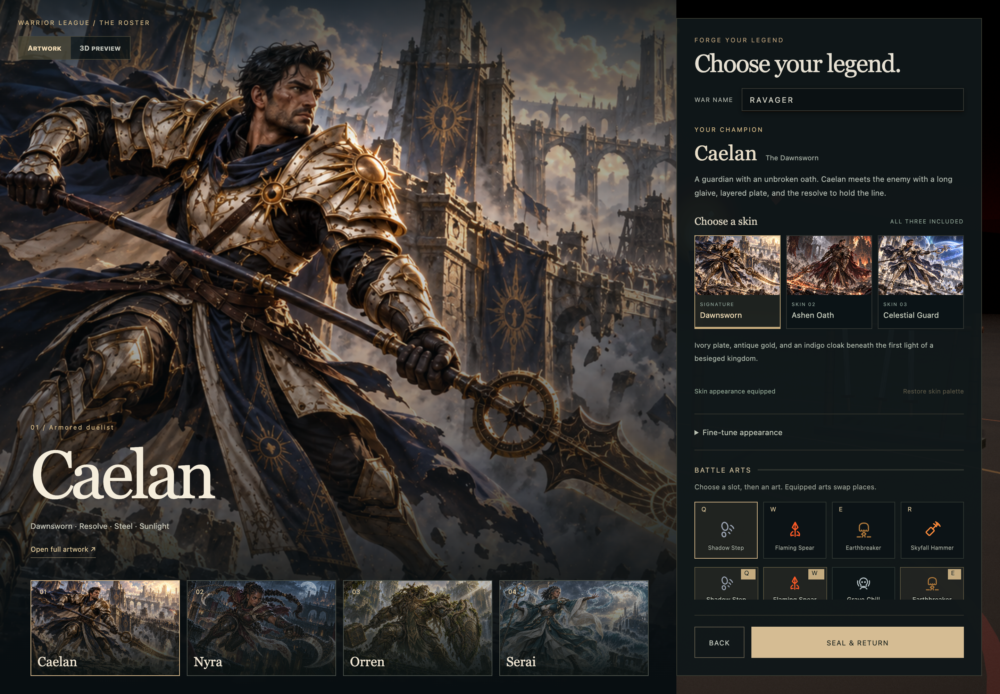

# Approved champion UI

Implemented locally on `feat/astra-immersive-realms`. Vivek accepted all four champions and all twelve skins, using the signature defaults below. Changes have not been deployed.

| Champion | Default skin | Included alternates |
|---|---|---|
| Caelan | Dawnsworn | Ashen Oath, Celestial Guard |
| Nyra | Veil Huntress | Lunar Phantom, Thornbound |
| Orren | Rootbound | Furnace King, Frost Relic |
| Serai | Tidecaller | Star Cartographer, Desert Oracle |

The forge presents a large splash illustration alongside the selected champion's identity, description, three skins, and battle arts. A four-character roster makes switching immediate. Artwork and 3D preview modes preserve access to the turntable and war dance. Fine-tune appearance expands paint, cape and trail controls, and Restore skin palette reapplies the selected costume's preset. Faces and hair now follow the authored character identity; the generic head/hair recombination controls have been removed.

Every champion remembers its selected skin. The saved choice supplies the hub portrait and all seven combat HUD portraits. Character and skin changes preserve the player's name, four equipped arts, stats, and destination realm. Existing custom appearance is retained on profile migration; new players start with Caelan / Dawnsworn.

## Verified controls and states

| Surface | Coverage | Result |
|---|---|---|
| Roster and skins | Four champions, all twelve looks on desktop and narrow screens, signature defaults, selected indicators, artwork, playable rig preset and palette | Passed |
| Persistence | Skin memory per champion, reload restoration, preservation of name/arts/stats; independent migration and save/load checks | Passed |
| Forge controls | War name, twelve arts and four slots, expandable appearance, palette restore enabled/disabled, Artwork/3D preview, turntable, dance on/off | Passed |
| Appearance controls | Original UI pass covered 22 swatches, 12 legacy head/hair combinations, two cape states and three trail states. The subsequent [model pass](champion-models.md) replaces generic heads/hair with twelve authored costumes. | See model verification |
| Navigation | Original artwork link, Back, Seal & return, hub portrait shortcut, Prepare loadout and destination-specific Enter battle in all seven modes | Passed |
| Responsive layout | Forge at 1440/1280/900/700/390/320px; portrait/resource clearance in seven games at 1600/1440/1280/900/700/390/320px | Passed |
| Keyboard and image states | Enter/Space selection, loading, failed artwork, working retry, selection remains usable during failure | Passed |
| Final visual check | All four default portrait crops, final forge screenshot, reduced-motion artwork behavior | Passed |
| Combat regressions | All four art tooltips in all seven modes at desktop/narrow widths; cinematic visibility rules | Passed |

The production build passes. `qa/probe-champion-ui.mjs` passes 121 assertions, and `qa/probe-field-tooltips.mjs` passes 64 assertions with no unexpected browser errors. `qa/inspect-champions.mjs` verifies the retained appearance controls and finite rigs. Results are saved in [champion-ui-results.json](champion-ui-results.json); detailed screenshots and initial failure evidence remain in the ignored `qa/screens/roster/` directory.

An independent Astra reviewer checked selection state, profile integrity, legacy migration, DOM ordering, and combat layout. Review and browser testing identified a mobile document-order issue and portrait/resource overlaps at intermediate widths. The final layout places the champion artwork before equipment on narrow screens and adjusts portrait placement in the affected HUDs. After the user requested removal of Chrome's debugging notification, browser control was released and verification continued in isolated headless Chrome instances.

## Production boundary

The illustrated character identities and twelve skins are integrated into the UI. The subsequent [character model implementation](champion-models.md) adds distinct bodies, faces, hairstyles, costume geometry, weapons, and secondary movement to the playable characters. These are stylized procedural models; reproducing the illustrations' sculpting and texture detail still requires further character art production. Champion selection does not change combat balance or replace the universal four-art loadout.

**Executive summary:** The complete approved roster is selectable, persisted, and represented across the forge, hub, and all seven combat HUDs. A separate model pass now supplies champion-specific playable bodies and equipment.
