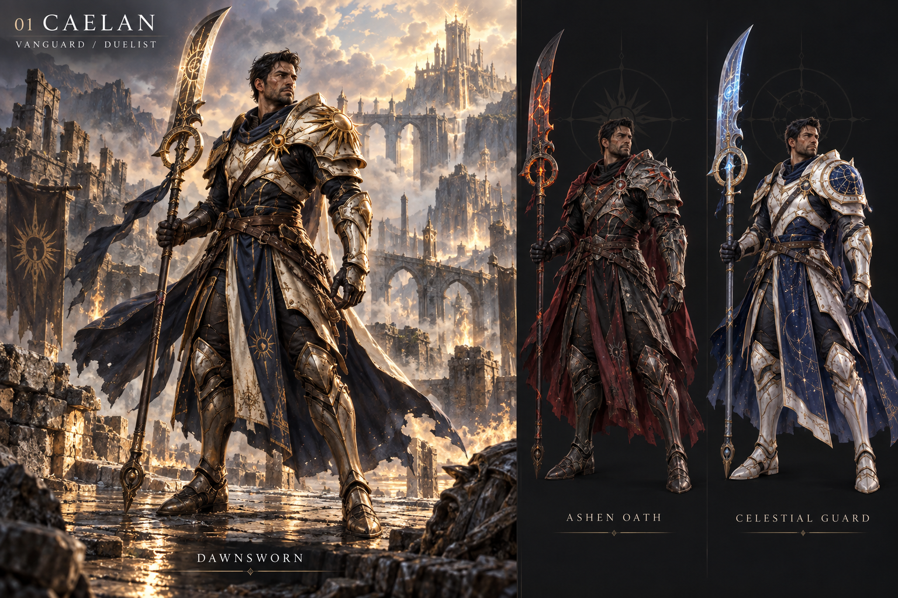
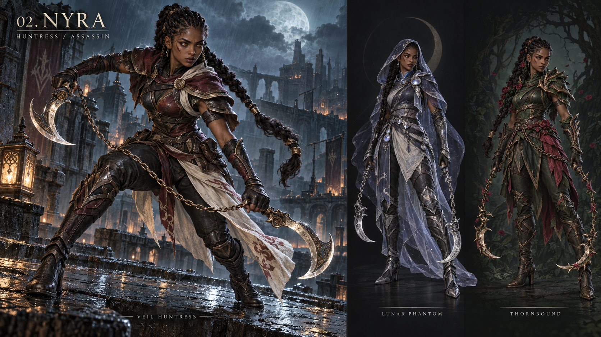
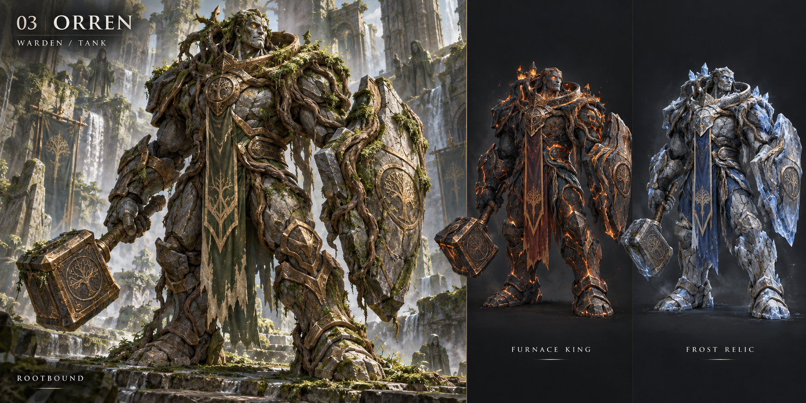
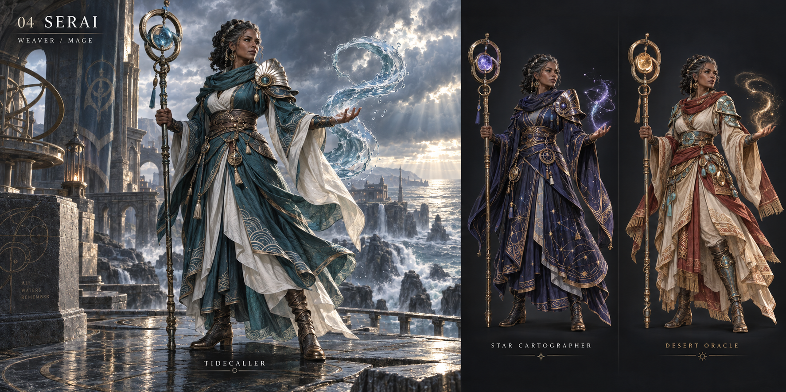

# Warrior League champion concepts

Four original champions, twelve individual splash illustrations, and four costume comparison boards, generated with the built-in imagegen tool on September 18, 2026. The art direction follows the user's request for the depth and finish of a premium fantasy MOBA character lineup, with coherent anatomy, distinctive silhouettes, detailed materials, and cinematic environments.

Open the [interactive gallery](../../../public/concepts/index.html) through the local Vite server at `/concepts/index.html`. It includes every illustration, plain-language descriptions, character filters, full-image viewing, zoom, keyboard navigation, and links to the original PNGs. No roster choice is needed to explore the collection.

A **character** is the person you would play. A **skin** is an alternate costume and visual theme for that same person. Each character below has a signature look and two alternate skins.

Vivek accepted all four champions and all twelve skins, with the signature looks as defaults. They are selectable in the game's forge and represented in the hub and combat HUDs. The [anatomical character rebuild](../../champion-models.md) replaces the rejected common body template with three separately morphed, skinned human anatomies and a distinct stone creature. It includes textured faces and hair, fitted costumes, and signature equipment. The illustrations remain the visual target; the live meshes are game adaptations. See also the [character UI implementation](../../champion-ui.md).

| Character and comparison board | Proposed play style | Signature illustration | Alternate illustrations |
|---|---|---|---|
| [01 Caelan](01-caelan.png) | Armored duelist who holds the front line | [Dawnsworn](../../../public/concepts/images/caelan-dawnsworn.png) | [Ashen Oath](../../../public/concepts/images/caelan-ashen-oath.png), [Celestial Guard](../../../public/concepts/images/caelan-celestial-guard.png) |
| [02 Nyra](02-nyra.png) | Agile huntress who darts into close combat | [Veil Huntress](../../../public/concepts/images/nyra-veil-huntress.png) | [Lunar Phantom](../../../public/concepts/images/nyra-lunar-phantom.png), [Thornbound](../../../public/concepts/images/nyra-thornbound.png) |
| [03 Orren](03-orren.png) | Colossal defender who protects allies | [Rootbound](../../../public/concepts/images/orren-rootbound.png) | [Furnace King](../../../public/concepts/images/orren-furnace-king.png), [Frost Relic](../../../public/concepts/images/orren-frost-relic.png) |
| [04 Serai](04-serai.png) | Ranged spellcaster who controls the battlefield | [Tidecaller](../../../public/concepts/images/serai-tidecaller.png) | [Star Cartographer](../../../public/concepts/images/serai-star-cartographer.png), [Desert Oracle](../../../public/concepts/images/serai-desert-oracle.png) |

Caelan carries a sun-etched glaive and layered plate armor. Nyra uses linked crescent blades, fitted leather armor, and a distinct braided silhouette. Orren combines stone, roots, bronze, a massive shield arm, and a bell hammer. Serai wears woven robes over lamellar armor and channels magic through a ring staff. The alternate skins preserve those identities while changing materials, costume details, and effects.

The generation prompts and output provenance are preserved in [board prompts](prompts.json) and [individual splash prompts](splash-prompts.json). Original tool outputs remain in the local generated-images directory; the project copies above are the durable references for this branch.

The playable models use additional textures generated with the built-in imagegen tool. [Face, metal and cloth prompts](model-texture-prompts.json) and the [hair atlas prompt](hair-texture-prompt.json) record their creation. Runtime WebP files are in [public/models/textures](../../../public/models/textures/); original generated PNGs are in [tools/character-assets/texture-sources](../../../tools/character-assets/texture-sources/). Mesh and eye-asset provenance is recorded in the [asset directory](../../../tools/character-assets/README.md).

The gallery passed 59 browser assertions covering all sixteen images, filters, image-viewer controls, focus restoration, keyboard behavior, loading/error/retry, original-image links, return-to-game links, and desktop/tablet/narrow layouts. See [the verification record](../../astra-immersion.md).

**Executive summary:** All four champions and twelve skins are approved and integrated into selection and gameplay, with signature defaults. The gallery preserves the full artwork as the reference for continued character art refinement.
