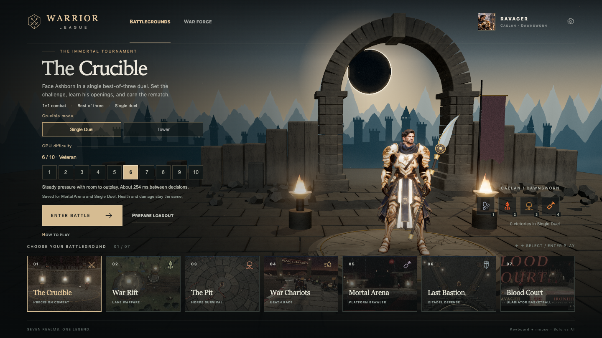

# CPU difficulty

Mortal Arena and The Crucible's Single Duel now offer levels 1 through 10. Level 6, Veteran, is the default. The hub presents ten numbered choices, a short description, and an approximate decision interval. The setting is shared by these two modes and saved on this device.

The Crucible still defaults to Tower. Select **Single Duel** to face Ashborn in one best-of-three bout with a configurable CPU. Tower keeps its four opponents and existing progression. War Rift, Blood Court, The Pit, War Chariots and Last Bastion retain their existing tuning.



## What changes during play

Higher levels make more frequent decisions, miss fewer attack opportunities, defend more reliably, and use the available moves more deliberately. Lower levels hesitate, miss defensive reads and leave more openings. All levels use the same fighter health, damage, movement speeds, hitboxes, jump physics and cooldown durations. Battle arts can still apply their ordinary temporary buffs.

Mortal Arena gives both enemy CPUs the selected level. Its Phantom Twin ally remains fixed at level 5, so choosing a tougher enemy does not strengthen the player's summon.

The pause menu shows the active level and lets the player save a new one. **The current match keeps its original difficulty.** The menu explicitly describes a pending change, and Begin Again starts at the new level. Resume continues the same match. Single Duel's Rematch uses the latest saved level.

## Authored calibration

Before this feature, Brawl used one fixed tuning: a base decision interval sampled between 200 and 350 ms, a 32% dodge roll on eligible decisions, and fixed targeting and recovery rules. Tower had four opponent-specific configurations. Their base reaction intervals remain 420, 300, 260 and 200 ms, with block probabilities of 25%, 40%, 55% and 70%.

The new behavior tiers interpolate between authored anchors at levels 1, 5 and 10. Level 5 is near the previous Brawl tuning, but is not an exact replay of the old AI. Level 6 makes the initial challenge somewhat stronger. The values below are probabilities per eligible decision or opening, not probabilities of winning a match.

| Brawl behavior | Level 1 | Level 5 | Level 6 | Level 10 |
|---|---:|---:|---:|---:|
| Base decision interval | 720 ms | 280 ms | 244 ms | 100 ms |
| Take an attack opening | 25% | 90% | 91.6% | 98% |
| Dodge a read attack | 3% | 32% | 41.6% | 80% |
| Choose smash against a target at 85%+ damage | 22% | 60% | 65.6% | 88% |
| Position anticipation | 0 ms | 80 ms | 104 ms | 200 ms |
| Offstage recovery jump threshold | -2.5 units | 0.8 units | 0.98 units | 1.7 units |

Brawl also retargets faster, prioritizes vulnerable opponents more strongly, and uses tighter spacing at higher levels. Movement follows the last sampled target position, with a short velocity estimate at higher levels. Recovery steers toward the island; stronger levels spend their air jump earlier while descending. Existing emergency recovery remains available to every level.

| Single Duel behavior | Level 1 | Level 5 | Level 6 | Level 10 |
|---|---:|---:|---:|---:|
| Base decision/read delay | 680 ms | 290 ms | 254 ms | 110 ms |
| Block a read attack | 6% | 42% | 51.2% | 88% |
| Attempt a combo continuation | 10% | 64% | 70% | 94% |
| Attempt an art cancel | 2% | 32% | 40.6% | 75% |
| Punish a nearby recovering attack | 2% | 38% | 48% | 88% |
| Quick-rise from a knockdown | 2% | 40% | 49.6% | 88% |
| Consider a useful battle art | 15% | 60% | 67% | 95% |

Single Duel also scales anti-air decisions, throw attempts against prolonged blocking, and approach choices. Art selection still requires a useful range, an available move and a completed cooldown. Cancel attempts also pass this art-selection check, so the listed cancel probability is not a guaranteed cast rate.

Reaction intervals vary by roughly 15% around their base to avoid robotic timing. The Single Duel brain observes visible attack state, waits for its read delay, then makes one block decision for that attack. It does not inspect keyboard input. Short attacks can land before the read completes. Each confirmed hit opening gets one combo decision; rendering more frames cannot turn a failed roll into a successful chain. Level 10 remains fallible.

These are authored settings with mechanical verification, **not levels fitted to human win-rate data**. Champion, loadout, positioning and match randomness affect practical difficulty. Do not interpret level 10 as a guaranteed win or a claim about professional fighting-game strength. Human playtesting remains the next source of balance adjustments, without changing the level selector or persistence contract.

## Match and storage contracts

- `cpuLevel`: integer 1 through 10, default 6. Finite numeric values round and clamp. Missing, blank or invalid values fall back to 6.
- `duelMode`: `tower` or `single`, default `tower`. Invalid explicit modes resolve to Tower.
- `ctx.cpuDifficulty`: immutable config captured when an eligible scene starts, otherwise null.
- Single Duel records plays and wins in `stats.*.duelSingle`. It never advances the Tower or increments Tower wins. Its result panel offers Rematch and Choose Battleground.
- `?scene=duel&mode=single&mute=1` opens Single Duel directly. Restart preserves the current mode, including when a direct link overrides the saved hub preference.

## Verification and coverage

The probes use isolated headless Chrome and local assets. They do not attach to the user's browser. Flow probes use real clicks and keyboard input for navigation and controls, and existing scene hooks to force round outcomes without depending on a human winning a match.

| Area | Checks |
|---|---|
| Hub choices | All ten levels, native arrow selection without realm navigation, saved state after reload, Tower/Single toggle, Brawl shared level, exclusions for five other games |
| Responsive UI | 1440x1000, 1440x900, 1440x810, 1280x720, 900x800 and 390x844; readable controls, accessible Enter Battle, expandable guide, no horizontal overflow |
| Pause | All ten levels, pending-change text, simulation freeze, Resume, Escape, Restart, focus wrapping, sound/motion toggles, all quality choices, narrow layouts |
| Single Duel | Forge-to-battle route, active HUD level, arrow movement, best-of-three, deciding KO/finisher, win/loss, separate stats, mobile rematch, hub return |
| Brawl | Both CPUs receive the chosen level, live movement/combat, restart applies pending changes, allied summon stays at level 5 |
| Tower regression | Four-fight progression, boss entrance, defeat, retry same foe, champion stats, automatic hub return and abandon |
| Mechanical behavior | Seeded tests of delayed blocks, pressure, combo probability at 30/60/120 FPS, art cooldowns, Brawl dodge/finishing decisions and offstage recovery |
| Persistence | Malformed/legacy values normalize without changing name, loadout or prior results; direct mode overrides and invalid-mode fallback |

At 60 FPS in 1,200 repeated heavy-attack scenarios, level 10 blocked before startup completed in 1,066 cases (88.8%). Level 1 missed the startup window in all cases because of its long reaction delay. In 1,200 isolated combo openings, level 1 followed up 130 times, versus 1,125 at level 10; the counts were identical at 30, 60 and 120 FPS. These fixtures measure actual brain decisions in controlled states, not full-match win rates.

Artifacts: [hub checks](cpu-ui-results.json), [match checks](cpu-match-results.json), [mechanical checks](cpu-behavior-results.json), [production hub checks](cpu-ui-results-production.json), [production match checks](cpu-match-results-production.json), and a [validation record with source hashes](cpu-validation.json). Screenshots are in `qa/screens/cpu/`. An independent reviewer inspected the new difficulty modules and integrations, including delayed reads, mode exclusions, result flow, snapshot semantics and fixed ally tuning, and reported no substantive findings.

All recorded checks pass. Visual QA caught and corrected clipping of Enter Battle at shorter desktop heights. The final hub layout passes at all six tested sizes. The production build succeeds, retaining its existing large shared-bundle warning.

```sh
npm run build
# With Vite dev at 5302 and the built preview at 5303:
node qa/probe-cpu-behavior.mjs
CPU_URL=http://127.0.0.1:5303 node qa/probe-cpu-ui.mjs
CPU_URL=http://127.0.0.1:5303 node qa/probe-cpu-matches.mjs
IPL_PORT=5302 node qa/probe-duel-tower.mjs
```

The behavior lab imports source modules, so it requires the development server. Set `CPU_URL` to override its default port.
